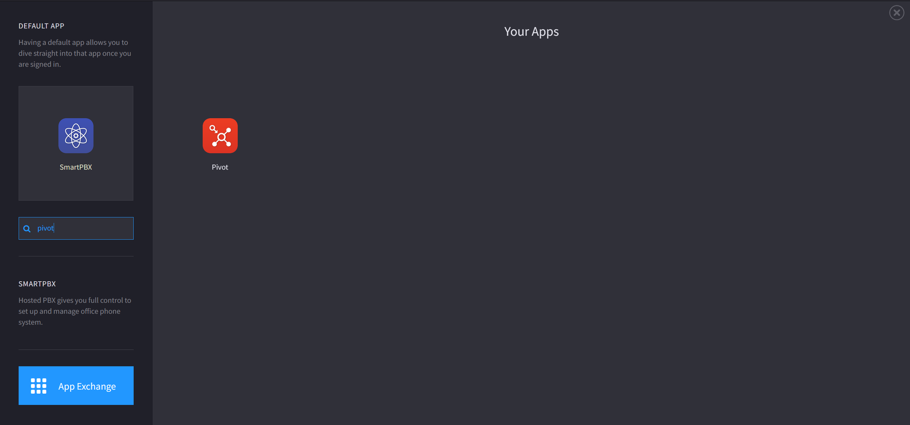
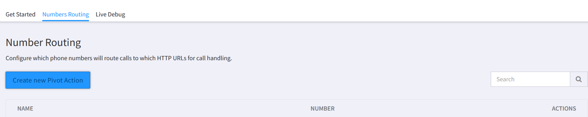
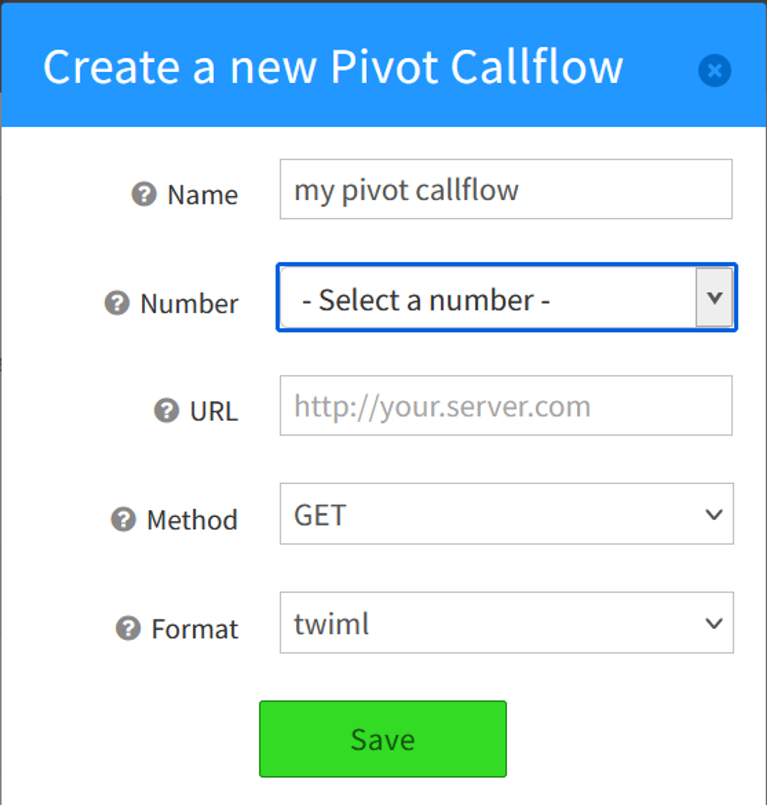
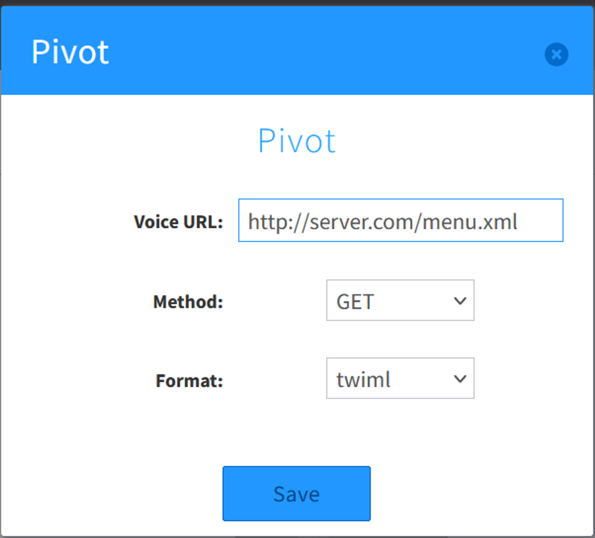

# Switching from Twilio

This tutorial shows you how to migrate an existing App from Twilio to Kazoo. Because [Pivot](https://docs.2600hz.com/git/2600hz/kazoo-pivot/doc/README.md) can render several common verbs from TwiML, it may be as simple as routing numbers in Kazoo to your existing TwiML servers, though Twilio apps built with Twilio Studio cannot be migrated using Pivot.

This tutorial also expects you to have a Kazoo account setup already. If you do not have a Kazoo account, contact us! This guide additionally does not cover configuring carriers, migrating numbers between carriers, setting up storage plans for recording, and other Kazoo configuration tasks.

## Migrating from Twilio SDK

If you built your application with Twilio's SDK or are otherwise hosting TwiML yourself, swapping Kazoo for Twilio is simple thanks to Pivot’s TwiML support. Your numbers just need to be routed to use your servers, which can be done using the Pivot webapp, the Callflow webapp, or the Callfow API.

Please note that Pivot will skip unsupported TwiML terms. See our [Pivot Documentation](https://docs.2600hz.com/kazoo/pivot/) for supported terms. Some TwiML terms can be swapped for 2600Hz Callflow actions with similar behaviors, demonstrated in the [IVR Tutorial](#ivr-demo).

You may also wish to review Pivot’s [request format.](https://docs.2600hz.com/git/2600hz/kazoo-pivot/doc/requests.md)

### Pivot App

Open your Kazoo account and find the Pivot app.



Open the Pivot app, and navigate to ‘Number’s Routing’.



Click on ‘create new pivot action’, then configure these fields. Usually, method will be `POST` depending on how your server is built. 



Once saved, Kazoo will route and process calls using your existing TwiML server.

### Callflows App

Create a new Callflow and add the Pivot action, found in the ‘advanced’ dropdown. Put the url of your developer server in the Voice URL field.



Once your number is routed to this Callflow, if you’re using supported TwiML terms and the appropriate request format and method for your TwiML server, it will have the same call behavior as before.

### Configure Routing with the Callflows API

The Callflows API is documented more completely [here](https://docs.2600hz.com/git/2600hz/kazoo-crossbar/doc/callflows.md), including ways to route multiple numbers at once. This is a brief guide on using that API. A new Callflow can be created with this Kazoo API endpoint:

```bash
curl -v -X PUT \
	-H "Content-Type:application/json" \
	-H "X-Auth-Token: {AUTH_TOKEN}" \
	-d '{"data": ... }' \
	http://{SERVER}:8000/v2/accounts/{ACCOUNT_ID}/callflows

```

The body of the request is JSON containing a Pivot Callflow pointing to your TwiML server:

```json
{
	"data":
	{
		"name":"my pivot callflow",
		"numbers":["555-113-0451"],
		"flow": {
			"module": "pivot",
			"data": {
				"method" : "get",
				"req_format": "twiml",
				"voice_url": "http://your_twiml_server.com/menu.xml"
			}
		}
	}
}
```

Your number is now routed to contact your server and process the same TwiML XML as before.

## Changeover from Twilio Studio

If you were using Twilio Studio before, you will need to create new Kazoo Callflows, either by [API](#configure-routing-with-the-callflows-api) or through the [Callflow drag-and drop editor.](https://docs.2600hz.com/notion/e8ac733d224e457ba4e40661853ec8c2#9c532d6f7dd8408c99a5f3a7acc75eee) 2600Hz does not recommend using Pivot for migrating from a Twilio Studio application at this time.

## IVR demo

This IVR, written with [Flask ](https://flask.palletsprojects.com/en/3.0.x/) and Twilio’s SDKs is fully supported by Pivot. A simple IVR such as this can be easily built using just the `menu` Callflow module, either in the web editor or with Kazoo JSON. 

```python
import flask

from twilio.twiml.voice_response import VoiceResponse

### helper functions for response headers

def pivot_twiml(body) :
    res = flask.Response(str(body))
    res.headers["Content-Type"] = "text/xml"
    return res

### Pivot request endpoints

@app.route("/", "main_menu")
def main_menu() :
    res = VoiceResponse()
    with res.gather(
        num_digits=1, action=flask.url_for("main_menu_action")
    ) as gather:
        gather.say(
            """Welcome to 2600Hz. For sub-menu sandwiches, press 1.
            To be connected to a fictitious operator, press 0."""
        )
    return pivot_twiml(res)

@app.route("/main_menu_action", methods=["POST"])
def main_menu_action() :
    match flask.request.form["Digits"]:
        case 0:
            return pivot_twiml(VoiceResponse().dial("555-113-0451"))
        case 1:
            return pivot_twiml(sub_menu())
        case _: 
            return pivot_twiml(VoiceResponse().redirect(flask.url_for("main_menu")))

@app.route("/sub_menu")
def sub_menu() :
    res = VoiceResponse
    with res.gather(
        num_digits=1, action=flask.url_for("sub_menu_action")
    ) as gather:
        gather.say(
            """For caprese, press 1.
            For banh mi, press 2
            to go back, press any other digit."""
        )
    return pivot_twiml(res)

@app.route("/sub_menu_action")
def sub_menu_action() :
    match flask.request.form["Digits"]:
        case 1:
            return pivot_twiml(VoiceResponse().say("Good choice and good bye"))
        case 2:
            return pivot_twiml(VoiceResponse().say("Good choice and good bye"))
        case _:
            return pivot_twiml(VoiceResponse().redirect(flask.url_for("main_menu")))

```

Pivot can also dynamically switch between rendering TwiML and Kazoo JSON with every request, so modifying this IVR to send an email notification whenever a user selects caprese requires little alteration:

```python
### An additional helper function--Pivot expects application/json headers when
### a server responds with Kazoo JSON.

def kazoo_json(body) :
    res = flask.Response(str(body))
    res.headers["Content-Type"] = "application/json"
    return res
    
### Pivot request endpoints

@app.route("/sub_menu_action")
def sub_menu_action() :
    match flask.request.form["Digits"]:
        case 1:
            return kazoo_json(caprese_callflow()) ### Changed!
        case 2:
            return pivot_twiml(VoiceResponse().say("Good choice and good bye"))
        case _:
            return pivot_twiml(VoiceResponse().redirect(flask.url_for("main_menu")))

### A simple function with a notification callflow

def caprese_callflow() :
    return """
    {
        "flow": {
            "data": {
                "recipients":[
                    {
                        "type":"email",
                        "id":"jc@unatco.com"
                    }
                ]
            },
        "module": "notification",
    }
    """
 
```

This `notification` callflow could be extended with more callflow children, including another `pivot` module if needed.